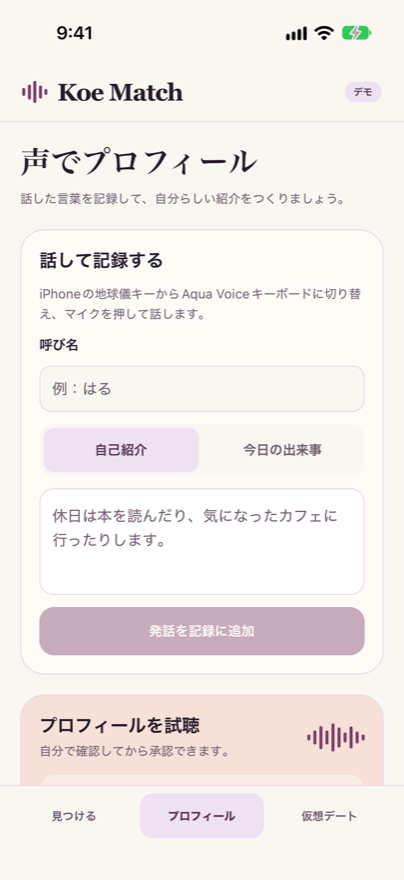
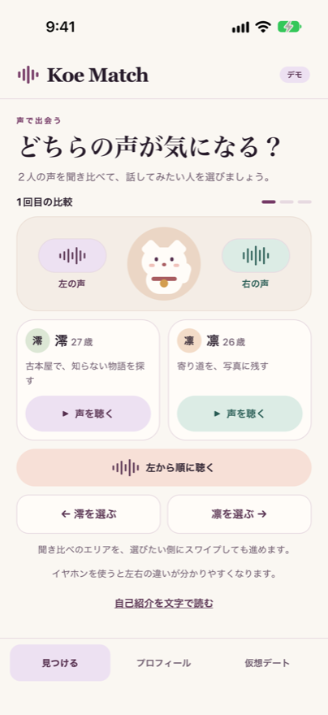
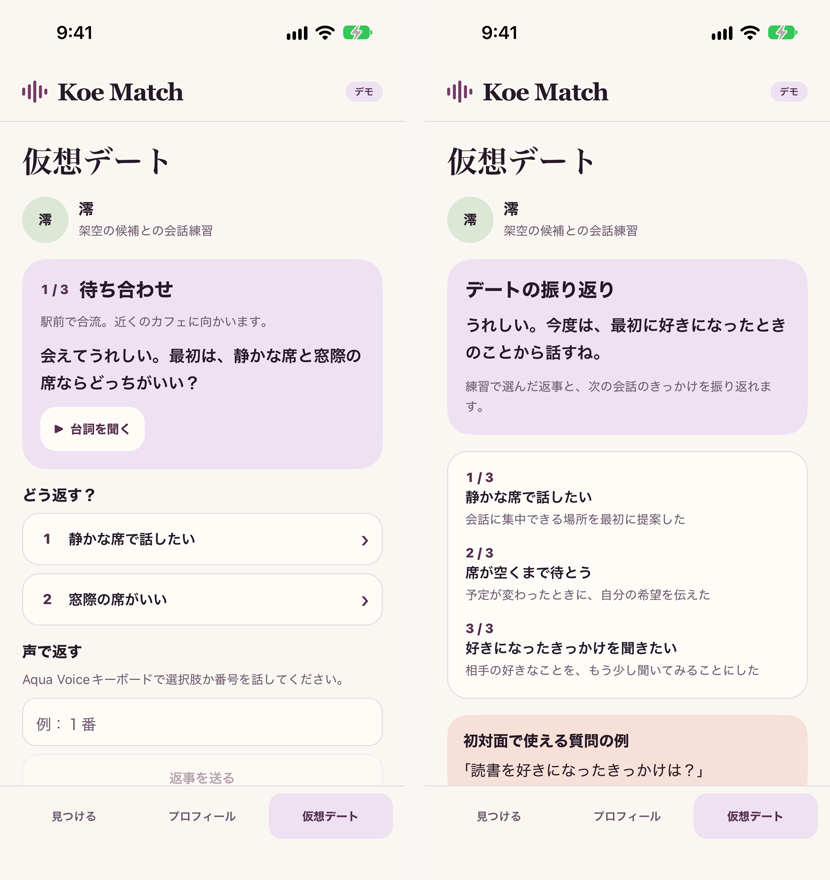

# AI HACKで「Koe Match」を作った。声を聴き比べて、会う前の会話を練習する


*Koe Matchのコンセプトイメージ（AI生成）*

## 作品名・キャッチコピー

**Koe Match ― 声で相手を知り、会う前に会話を練習できるマッチングアプリ。**

2026年11月23日の「AI HACK SPECIAL ONE-DAY HACKATHON」に参加し、声で相手を知るマッチングアプリ「Koe Match」を作りました。開発では、打ち合わせの記録やCodexへの開発指示を入力するのにAqua Voiceを使いました。[イベント概要](https://hackcommons.com/hackathons/aihackathon-jp-special-1123-1yrel3l)

## 解決したい困りごと

AI HACKのお題は「話すだけで 誰かの面倒を減らすアプリ」。家事やカフェ業務などで声が役立つ場面を出し合い、打ち合わせでマッチングアプリに企画を絞りました。

マッチングアプリで自分を紹介する文章を書くのが苦手な人は、自己紹介欄を前に、何を書けば伝わるか考えるところから始めます。相手のプロフィールを読んでも、初対面でどんな話をすればいいかは想像しにくい。普段の言葉で自己紹介を話し、会う前に会話を一度練習できれば、文章と話題を考える手間を減らせると考えました。

## アプリでできること

当日のデモには、話した内容からプロフィールを作る、２人の声を聴き比べて相手を選ぶ、選んだ相手との会話を練習する、という３つの体験を入れました。React Native、TypeScript、Expo SDK 58で実装しています。[Expo SDK 58公式リファレンス](https://docs.expo.dev/versions/v58.0.0/)

| 機能 | 使うとどう変わるか |
| --- | --- |
| 音声プロフィール | 自己紹介や日記の記録から下書きができ、空欄から文章を組み立てる手間を減らせる。 |
| 左右の声の比較 | ２人の自己紹介を聴き、話し方や声も相手を選ぶ材料にできる。 |
| 仮想デート | 返答を選びながら会話を練習し、初対面で聞きたい質問を見つけられる。 |

## アプリの使い方

「はじめる」を押すと「見つける」が開きます。ここでは、先にプロフィールを作ってから仮想デートまで進む流れを紹介します。候補の比較はプロフィール作成前にも試せます。

### 1. 話したことをプロフィールにする

「プロフィール」タブを開き、呼び名を入れます。「自己紹介」か「今日の出来事」を選び、「休日は本を読んだり、気になったカフェに行ったりします」のような内容を入力して「発話を記録に追加」を押します。

「端末内で下書きを作る」を押すと、記録から紹介文ができます。自分で直し、端末の合成音声で聴いてから「紹介文を承認する」を押すと、承認状態が端末に保存されます。



*iOSシミュレーターのプロフィール画面。入力欄には例文を表示しています。*

### 2. 左右の声を聴き比べて選ぶ

「見つける」では、一度に２人ずつ表示します。「左から順に聴く」を押すと、左と右の候補の自己紹介が順番に流れます。ボタンかスワイプで気になる方を選び、２組から選んだ候補を３回目に聴き比べます。自己紹介は文字でも読めます。

デモの４人は架空の成人です。声はIrodori-TTSで合成し、１人につき左寄りと右寄りの２本、合計８本のステレオ音声を同梱しました。アプリは表示位置に合う音声ファイルを再生し、画面では再生中の側を表示します。ヘッドホンを使うと声の位置の違いが分かりやすくなります。相手側の興味はデモ用の設定で再現しています。[Irodori-TTSモデルカード](https://huggingface.co/Aratako/Irodori-TTS-v4.1-Small)



*iOSシミュレーターの候補比較画面。再生と候補の選択は別々のボタンです。*

### 3. 仮想デートで、次に聞きたいことを見つける

候補が決まったら「仮想デートへ」を押します。待ち合わせ、予定変更、別れ際の３場面を進めます。たとえば待ち合わせなら「静かな席で話したい」「窓際がいい」から選べます。ボタンをタップするほか、入力欄に選択肢の番号や返答を入れて送れます。最後には、選んだ返答と「読書を好きになったきっかけは？」のような、初対面で使える質問の例が残ります。



*iOSシミュレーターで撮影した待ち合わせと振り返りの画面。*

## Aqua Voice・AIの活用方法

打ち合わせの長い記録や、その後の開発指示をAqua Voiceで音声入力し、テキストをCodexに渡しました。話題が行き来する記録から、減らしたい手間、デモで見せる３機能、担当範囲、未決事項を抜き出し、実装の単位に分けました。プロフィール、候補比較、仮想デートは複数のエージェントで並行して進め、画面部品、ナビゲーション、保存や音声再生を共通のアプリに統合しました。

アプリでは、iPhoneの入力欄で地球儀キーからAqua Voiceキーボードに切り替え、マイクで話す想定です。文字になった内容を確認してから、プロフィールなら「発話を記録に追加」、仮想デートなら「返事を送る」を押します。この一連の操作をAqua Voiceキーボードで通す実機検証は、今後行います。[Aqua VoiceのiPhone向け公式ガイド](https://aquavoice.com/guide/getting-started-iphone)

プロフィールで「AIで下書きを作る」を選ぶと、任意の開発用APIが呼び名と保存済みの記録をOpenAIに渡し、自己紹介の草案を生成します。箇条書きや話し言葉を一から文章に整える手間を減らせます。仮想デートでは、自由質問とその場面の設定を渡し、候補からの返答を生成します。

## 工夫したこと

- **聞きやすさと選びやすさ**。再生中の側を音波で示し、左右の位置を耳と画面の両方で追えるようにしました。自己紹介の文字表示と選択ボタンも用意しました。
- **確認してから進める操作**。プロフィールは下書きの編集と試聴を経て、本人が承認します。仮想デートは選択肢が特定できたときに進み、曖昧な返事にはその場で聞き直します。AIが自由質問に答えたときも、次の行動は自分で選びます。

### 外部サービスを設定せずにデモを動かす

基本のデモは、端末内で作る紹介文、端末の合成音声、同梱したサンプル音声、台本の分岐で動きます。iOSの開発ビルドはローカルのXcodeで作り、シミュレーターで動かします。

```sh
npm ci
npm run ios
```

任意のローカル開発用APIには、OpenAIで紹介文の草案や自由質問への返答を生成する経路と、ElevenLabsで本人が同意した録音を登録・試聴・削除する経路を用意しました。APIキーは開発用サーバー側で扱います。

### 2026年11月23日までに確認したこと

| 確認方法 | 確認したこと |
| --- | --- |
| Xcode・iPhone 17シミュレーター | アプリ起動、候補比較とプロフィールの行き来、スワイプとボタンでの選択、仮想デート３場面と振り返り。起動画面で２つの波形が重なる演出は録画で確認。 |
| モバイル幅のChromium | 左右の音声の連続再生と停止、３回の比較、仮想デートの完了、再読み込み後のプロフィール承認状態。 |
| 外部サービスを模擬したAPIテスト | 紹介文と返答の生成、音声登録の重複防止、試聴、削除。 |
| 型チェック・Lint・Expoのバンドル出力 | 型チェックとLintの通過、iOS・Android・Web向けバンドルの出力。 |

## 今後の展望

まず、iPhoneで実際に話して文字起こしを確認し、プロフィールに記録したり、仮想デートの返答を送ったりする一連の操作を検証します。入力を言い直したい場合に、どこで修正すればよいかが分かるかも確かめます。OpenAIとElevenLabsは実サービスでの動作確認を進めます。

実ユーザー同士の相互マッチングは今後の設計項目です。双方が興味を示したあと、どの段階でプロフィールや声を相手に共有するかを検討します。
