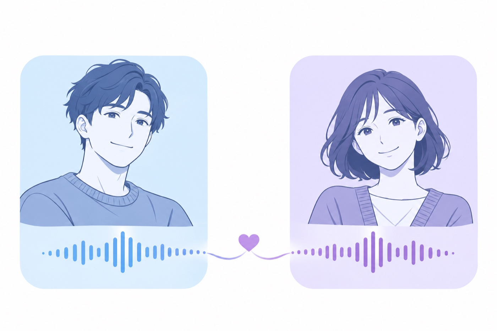
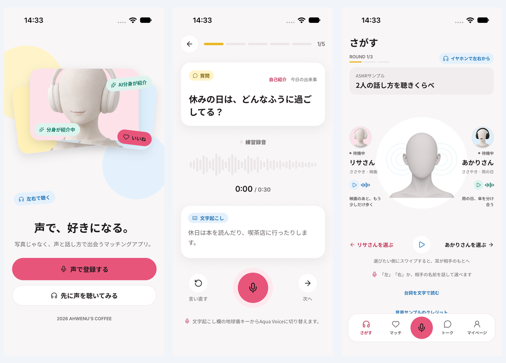
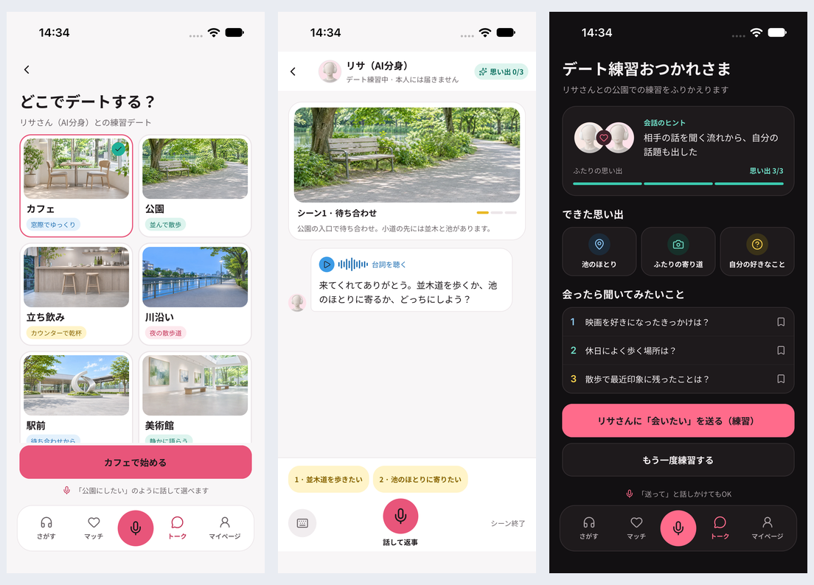
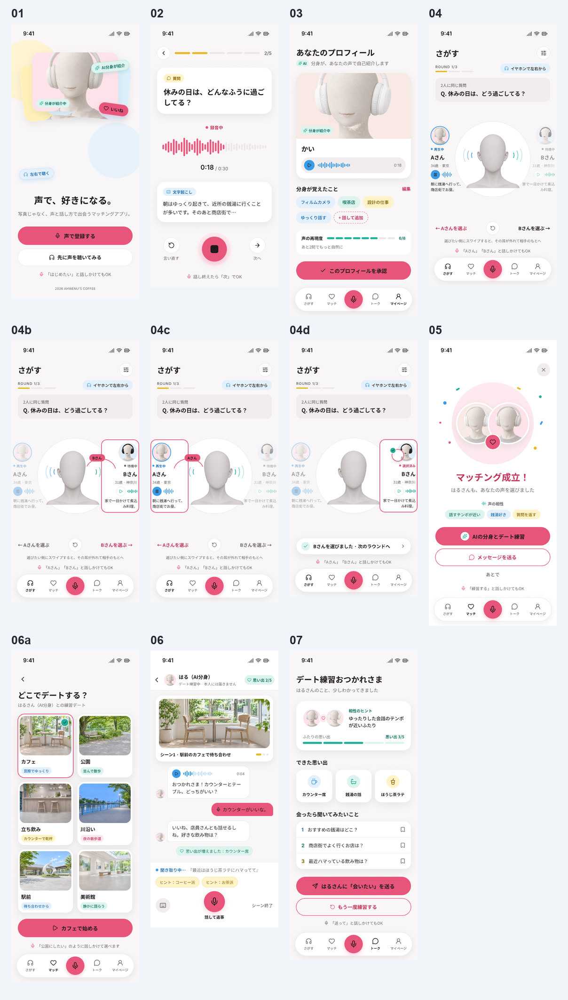
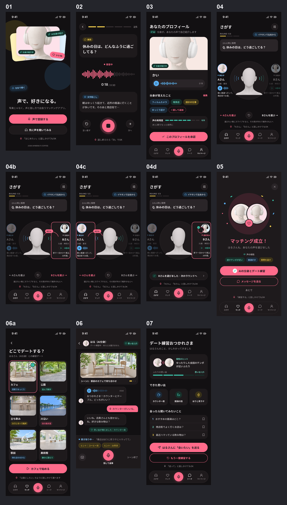

# AI HACKで「Koe Match」を作った。声を聴き比べて、会う前の会話を練習する



*Koe Matchのコンセプトイメージ（AI生成）*

## 作品名・キャッチコピー

**声で、好きになる。** Koe Matchは、声で相手を知り、会う前に会話を練習できるマッチングアプリです。

2026年11月23日の「AI HACK SPECIAL ONE-DAY HACKATHON」に参加し、声で相手を知るマッチングアプリ「Koe Match」を作りました。開発では、打ち合わせの記録やCodexへの開発指示を入力するのにAqua Voiceを使いました。[イベント概要](https://hackcommons.com/hackathons/aihackathon-jp-special-1123-1yrel3l)

## 解決したい困りごと

AI HACKのお題は「話すだけで 誰かの面倒を減らすアプリ」。家事やカフェ業務などで声が役立つ場面を出し合い、打ち合わせでマッチングアプリに企画を絞りました。

マッチングアプリで自分を紹介する文章を書くのが苦手な人は、自己紹介欄を前に、何を書けば伝わるか考えるところから始めます。相手のプロフィールを読んでも、初対面でどんな話をすればいいかは想像しにくい。普段の言葉で自己紹介を話し、会う前に会話を一度練習できれば、文章と話題を考える手間を減らせると考えました。

## アプリでできること

2026年11月23日時点のデモには、話した内容からプロフィールを作る、２人の声を聴き比べて相手を選ぶ、選んだ相手との会話を練習する、という３つの体験を入れました。Pen.devで設計したv3.3の画面をReact Native、TypeScript、Expo SDK 58で実装し、端末の設定に合わせてライトとダークを切り替えます。[Expo SDK 58公式リファレンス](https://docs.expo.dev/versions/v58.0.0/)

| 機能 | 使うとどう変わるか |
| --- | --- |
| 音声プロフィール | 自己紹介や日記の記録から下書きができ、空欄から文章を組み立てる手間を減らせる。 |
| 左右の声の比較 | ２人のサンプルを片耳ずつ聴き、話し方や声も相手を選ぶ材料にできる。比較の途中でアプリを閉じても再開できる。 |
| 仮想デート | ６つの場所から場面を選び、返答を練習して初対面で聞きたい質問を見つけられる。 |

## アプリの使い方

起動画面では「声で登録する」と「先に声を聴いてみる」を選べます。ここでは、自己紹介からデート練習まで進む順に紹介します。

### 1. 話したことをプロフィールにする

「声で登録する」を押し、画面の質問をきっかけに「休日は本を読んだり、気になったカフェに行ったりします」のように答えます。Aqua Voiceキーボードで入力した文字を確認して「次へ」を押すと、最初の回答から紹介文の下書きが作られます。iOSでは別に、マイクボタンで練習録音を取り、その場で聴き返せます。

下書きは編集し、端末の合成音声で聴いてから「このプロフィールを承認」で確定できます。あとから「マイページ」の「話して追加」で自己紹介や今日の出来事を追記し、下書きを作り直せます。記録と承認状態は端末に保存されます。

### 2. 左右の声を聴き比べて選ぶ

「さがす」では、一度に２人ずつ表示します。「左から順に聴く」で候補の声が順に流れます。左右のスワイプ、候補の選択ボタン、キーボードからの「左」「右」や候補名の入力で相手を選べます。２組から選んだ候補を３回目に聴き比べる構成で、選んだ候補IDを保存するためアプリを開き直しても途中から再開できます。「声を選び直す」で最初から始められます。

比較の試聴には、関連企画Voice-matchingが採用した合成ASMR音声から、リサ・あかり・しおり・さなの４本を使っています。１人につき左用・右用で２本、合計８本を同梱しました。「台詞を文字で読む」から試聴音声と同じ台詞を読めます。各音源のVOICEVOXクレジットも比較画面に掲載しています。[Voice-matchingの音声資料](https://github.com/Jun0908/Voice-matching/blob/a3a0c46ed48fbb3087741ec421eeee39e491c8a1/docs/AUDIO.md)



*Expo版v3.3の実画面。左から起動、質問に答える自己紹介、左右の声を比べる「さがす」。*

### 3. 仮想デートで、次に聞きたいことを見つける

候補が決まったら「AIの分身とデート練習」を押し、カフェ、公園、立ち飲み、川沿い、駅前、美術館から場所を選びます。その場所に合わせた待ち合わせ、予定変更、別れ際の３場面で、選択肢をタップするか、番号や返答を入力して進みます。最後に、選んだ返答と初対面で使える質問を見返せます。マッチング成立の表示、メッセージ、「会いたい」は、架空の候補を使った練習用の体験です。



*Expo版v3.3の実画面。左から場所選択、公園での待ち合わせ、３場面を終えたあとの振り返り。振り返りはダーク表示。*

## Aqua Voice・AIの活用方法

打ち合わせの長い記録や、その後の開発指示をAqua Voiceで音声入力し、テキストをCodexに渡しました。話題が行き来する記録から、減らしたい手間、デモで見せる３機能、担当範囲、未決事項を抜き出し、実装の単位に分けました。プロフィール、候補比較、仮想デートは複数のエージェントで並行して進め、画面部品、ナビゲーション、保存や音声再生を共通のアプリに統合しました。

アプリでは、iPhoneの入力欄で地球儀キーからAqua Voiceキーボードに切り替え、マイクで話す想定です。文字になった内容を確認し、自己紹介は「次へ」、聴き比べは「実行する」、デート練習は「返事を送る」で確定します。聴き比べで「次」を入力すると、再生中の側や選択状態に応じて、もう一方の声の試聴や次の比較へ進めます。Aqua Voiceキーボードを使った実機での通し検証は今後行います。[Aqua VoiceのiPhone向け公式ガイド](https://aquavoice.com/guide/getting-started-iphone)

プロフィールで「AIで下書きを作る」を選ぶと、任意の開発用APIが呼び名と保存済みの記録をOpenAIに渡し、自己紹介の草案を生成します。箇条書きや話し言葉を一から文章に整える手間を減らせます。仮想デートでは、自由質問とその場面の設定を渡し、候補からの返答を生成します。

## 工夫したこと

### Pen.devで設計した画面一覧

初期案ではポップな配色と顔写真を使い、次の案では声紋で人物を表しました。v3.3は白とローズを中心に、ヘッドホンを着けたマネキンで人物を表現しています。再生は青、AIの分身や相性の表示はミント、進み具合やヒントは黄にそろえました。比較画面の頭と左右の耳は画像を別レイヤーにして、スワイプ中と候補を選んだ直後を描き分けています。

作業中の [Pen.devファイル](../design/koe-match.pen) から、基本７画面、スワイプに伴う３状態、場所選択１画面を、ライト・ダーク各11枚書き出しました。



*Pen.devから書き出したライト版。番号は下の一覧に対応。*



*Pen.devから書き出したダーク版。*

| 番号 | Pen.devの画面名 | 画面で示すこと |
| --- | --- | --- |
| 01 | はじめに | 声で登録するか、先に聴き比べを体験するかを選ぶ。 |
| 02 | 声で自己紹介 | 質問に答えて、文字起こしを確認する。 |
| 03 | プロフィール確認 | 自己紹介を試聴し、編集・承認する。 |
| 04 | 左右で聴きくらべ | ２人の声を聴き、再生中の側を確認する。 |
| 04b | 右にスワイプ中 | 右の候補を選ぶ途中の状態を示す。 |
| 04c | 左にスワイプ中 | 左の候補を選ぶ途中の状態を示す。 |
| 04d | Bさんを選択 | 選んだ候補を次の比較に進む前に確認する。 |
| 05 | マッチング成立 | デモのマッチ結果からデート練習に進む。 |
| 06a | シチュエーションを選ぶ | ６つの場所から練習する場面を選ぶ。 |
| 06 | デート練習 | 選んだ場所で、場面ごとに返答する。 |
| 07 | デートのふりかえり | 選んだ返答や、会ったときに聞きたい質問を見返す。 |

### Expo版に取り込んだ操作

- **聞きやすさと選びやすさ**。再生中の側を音波で示し、左右の位置を耳と画面の両方で追えるようにしました。台詞の文字表示と選択ボタンも用意しました。片方を聴き終えたあとに「次」と入力しても、もう一方を試聴できます。
- **確認してから進める操作**。自己紹介の入力中は文字を残したままキーボードを閉じられます。プロフィールは下書きの編集と試聴を経て、本人が承認します。仮想デートでは「２番でお願いします」のように番号で選べます。曖昧な返事にはその場で聞き直し、AIが自由質問に答えたときも次の行動は自分で選びます。
- **場所を選んですぐ始める配置**。iOSの検証で、場所カードが縦に伸び、デートの開始ボタンが画面外に押し出されることが分かりました。カードを２列に組み、画面の高さに合わせて写真の高さを調整し、開始ボタンを画面下部に配置しました。

関連企画のWeb版を参照し、比較の再開と片耳だけの再生をExpo版にも反映しました。３回の比較に合わせて保存した候補IDを起動時に照合し、続きの組み合わせや選び終えた相手を復元します。新しい音源に切り替えた際は、以前の音源で選んだ結果を新しい候補に結び付けないよう、比較を最初から始めます。音源８本はデコードして、再生側と反対のチャンネルがすべて無音であることを確認しました。[取り込みの記録](voice-matching/integration.md)

### 外部サービスを設定せずにデモを動かす

基本のデモは、端末内で作る紹介文、端末の合成音声、同梱したサンプル音声、台本の分岐で動きます。iOSの開発ビルドはローカルのXcodeで作り、シミュレーターで動かします。

```sh
npm ci
npm run ios
```

任意のローカル開発用APIには、OpenAIで紹介文の草案や自由質問への返答を生成する経路と、ElevenLabsで本人が同意した録音を登録・試聴・削除する経路を用意しました。APIキーは開発用サーバー側で扱います。

### 2026年11月23日までに確認したこと

| 確認方法 | 確認したこと |
| --- | --- |
| Pen.dev v3.3 | ライト・ダーク各11画面のフレームを確認し、記事用に書き出し。 |
| v3.3のiOSシミュレーター | Xcodeの開発ビルドが成功。ライトでは自己紹介の入力・承認から、新しい音源の試聴、３回の比較、マッチ、公園のデート練習と振り返りまで通過。比較途中、確定した相手、選び直し後の状態を再起動で確認。ダークでは６つの場所それぞれで３場面を進め、場所ごとの質問が振り返りに出ることを確認。「次」で試聴する側を切り替える操作と、丁寧な番号指定で場面を進める操作は、テスト用の文字列を貼り付けて検証した。 |
| v3.3の静的確認と出力 | 型チェックとLintが通過。iOS・Android・Web向けのバンドル出力を確認。 |
| v3.3のモバイル幅のChromium | 新しい台詞と４音源のクレジットを表示。左の試聴が終わってから「次」の入力で右の音声が再生され、再読み込み後は比較の続きが開くことを確認。 |
| v3.3統合前のiOSシミュレーター・Chromium | 候補選択、仮想デート３場面と振り返りまで確認。Chromiumでは左右の連続再生・停止と、再読み込み後のプロフィール承認状態も確認。 |
| 外部サービスを模擬したAPIテスト | 紹介文と返答の生成、音声登録の重複防止、試聴、削除。 |

## 今後の展望

iPhoneでは実際に話し、文字起こしの確認、言い直し、プロフィールの記録やデート練習の返答を送るまでの操作を検証します。イヤホンでの左右の聴こえ方と、OpenAI・ElevenLabsの実サービスでの動作確認も進めます。

実ユーザー同士の相互マッチングは今後の設計項目です。双方が興味を示したあと、どの段階でプロフィールや声を相手に共有するかを検討します。
